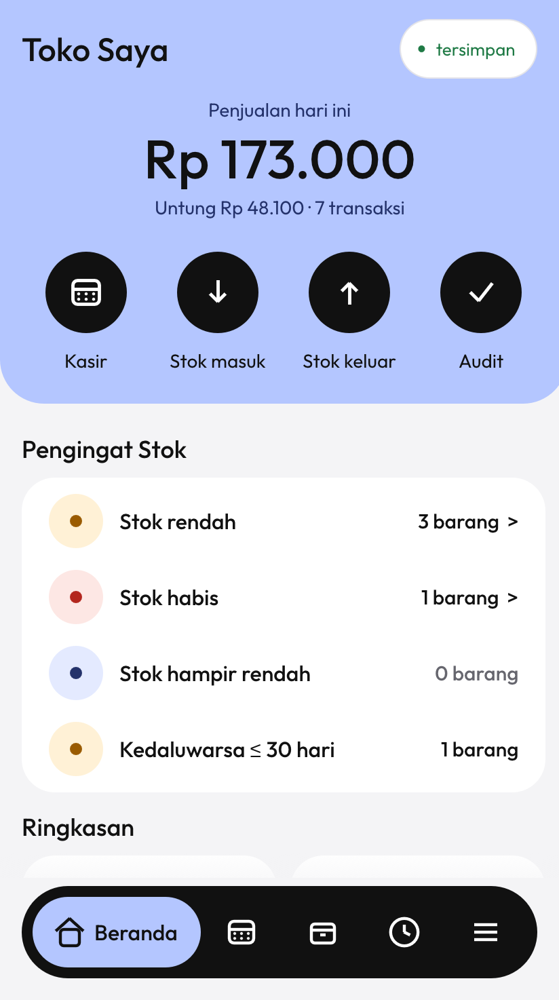
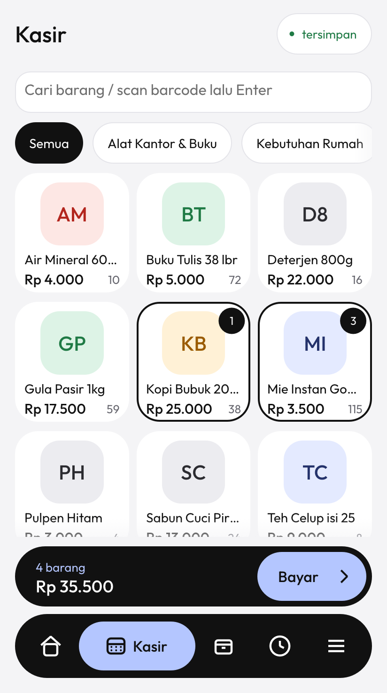
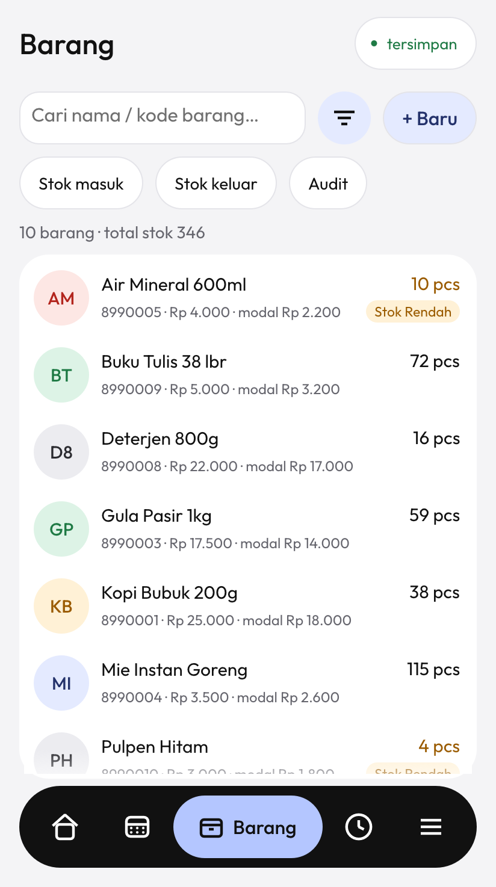
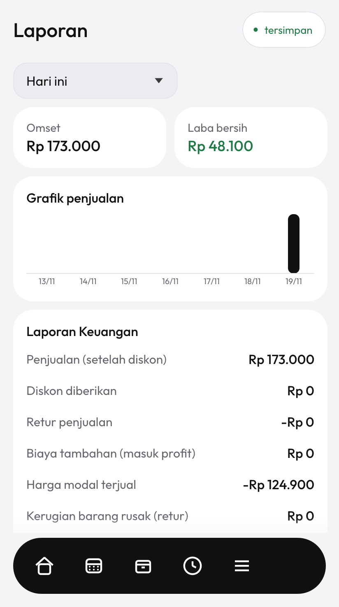

<p align="center">

</p>

<h1 align="center">Bakadai Lite</h1>

<p align="center"><a href="https://github.com/andipyk/bakadai-lite/releases/latest"><b>Unduh APK terbaru</b></a></p>

Aplikasi **stok barang & kasir** yang ringan untuk HP Android, dibuat dengan Rust.
Jalan penuh **tanpa internet** (data di HP), lalu bisa **sinkron ke REST API milik Anda** saat online.
Staff, barang, riwayat, dan biaya tambahan **tanpa batas**.

<p>




</p>

| | App Lain | Bakadai Lite |
|---|---|---|
| Ukuran APK | ±23 MB (APK dasar, belum termasuk split) | **±4,5 MB** |
| Izin HP | 47 | **3** (internet untuk sinkron, Bluetooth untuk printer struk, kamera untuk scan barcode) |
| Butuh internet | Ya (Firebase) | Tidak (offline-first) |
| Batas staff / barang / riwayat | 3–100 staff, 500–2.000 barang, 180–360 hari | **Tanpa batas** |
| Foto produk | Diunggah apa adanya, data lokasi ikut tersimpan | Dikompres di HP, data lokasi dibuang |

---

## 1. Isi folder

| File / folder | Untuk apa |
|---|---|
| `app/BakadaiLite.apk`, `app/BakadaiLite.aab` | APK siap pasang (Android 7.0+, HP 64-bit/arm64) dan bundle untuk Play Store (tidak masuk git, buat dengan `build-apk.sh`) |
| `README.md` | Dokumen ini: ringkasan, cara pakai, ringkasan kontrak API |
| `design/` | Desain FigCraft v2, aset & teks Play Store |
| `app/HANDOVER.md` | **Panduan developer** yang melanjutkan: arsitektur, cara build, cara menambah fitur, daftar pekerjaan |
| `app/API_CONTRACT.md` | **Kontrak REST API lengkap** (endpoint, bentuk data, aturan bisnis, kode error) |
| `app/ANDROID.md` | Cara membuat APK & batasan versi Android |
| `app/build-apk.sh` | Satu perintah untuk membuat ulang APK + AAB |
| `app/src/` | Kode program (Rust) |
| `app/.tools/` | Alat pembuat APK + kunci tanda tangan (tidak masuk git) |

---

## 2. Cara pakai (untuk pemilik toko)

### Pasang di HP
1. Unduh `BakadaiLite.apk` dari [Releases](https://github.com/andipyk/bakadai-lite/releases/latest) langsung di HP, atau kirim file-nya ke HP (WhatsApp ke diri sendiri, Google Drive, atau kabel USB).
2. Buka file-nya. Bila diminta, izinkan **"Instal aplikasi tidak dikenal"** untuk aplikasi tersebut.
3. Buka **Bakadai Lite**. Saat pertama dibuka sudah ada **data contoh** (10 barang, beberapa transaksi) supaya mudah dicoba.
4. Mata uang awal Rupiah (bisa diganti di Pengaturan). Tombol kembali Android menutup layar; di layar terakhir tekan dua kali untuk keluar.

### Menu bawah
| Menu | Isi |
|---|---|
| **Beranda** | Penjualan & untung hari ini, tombol cepat (Kasir, Stok Masuk, Stok Keluar, Audit), pengingat stok rendah/habis/kadaluwarsa, piutang, nilai stok, transaksi terakhir |
| **Kasir** | Pilih barang (ketuk kotak barang atau scan barcode; tombol **−** merah di kotak untuk mengurangi), keranjang, harga grosir otomatis, diskon (% atau Rp), biaya tambahan, pilih pembeli, metode bayar, uang diterima + kembalian (atau sisa jadi piutang), struk |
| **Barang** | Daftar barang (cari, filter kategori, stok rendah/habis, urutkan), tambah/ubah barang, foto (dikompres otomatis), harga grosir, riwayat per barang |
| **Riwayat** | Semua transaksi (penjualan, stok masuk, audit, retur), filter tanggal/jenis/belum lunas; buka untuk lihat struk, cetak, tambah pembayaran, buat retur, hapus |
| **Lainnya** | Pembeli, Vendor, Laporan Piutang, Pengeluaran, Laporan, Staff, Kategori, Metode Pembayaran, Biaya Tambahan, Pengaturan, Server & Sinkron |

### Tugas sehari-hari
- **Jual barang**: Kasir → ketuk barang → `Bayar` → isi uang diterima (atau tombol Uang Pas / 20.000 / 50.000…) → `Bayar`.
- **Barang datang dari supplier**: Beranda → *Stok Masuk* → cari barang → isi jumlah & harga modal → Simpan. Harga modal dihitung ulang otomatis (rata-rata tertimbang).
- **Hitung ulang stok di rak**: *Audit* → isi stok hasil hitung → Simpan (tidak masuk laporan keuangan).
- **Pembeli bayar utang**: Riwayat → buka transaksi → *Tambah Pembayaran*.
- **Barang dikembalikan pembeli**: Riwayat → buka penjualan → *Buat Retur* (pilih jumlah rusak bila ada).
- **Tambah staff**: Lainnya → Staff → *Tambah Staff* → pilih peran → centang akses. Ganti staff yang sedang memakai HP di menu Lainnya (bagian atas).
- **Laporan**: Lainnya → Laporan → pilih periode → lihat omset, laba, terlaris; tombol *Unduh* membuat file CSV yang bisa dibuka di Excel.
- **Cetak struk**: Pengaturan → pilih printer Bluetooth yang sudah di-pair di HP, atau isi alamat printer jaringan (contoh `192.168.1.50:9100`), ukuran kertas 58/80 mm → di detail transaksi tekan *Cetak*. Pencetakan jalan di latar, layar tidak macet. Bisa juga *Auto-print* setelah bayar dan buka laci kasir otomatis.
- **Scan barcode pakai kamera**: ketuk ikon scan di sebelah kolom cari (Kasir, Stok Masuk/Keluar/Audit, Barang) atau di kolom Kode Barang saat menambah barang. Masukkan seluruh barcode ke kotak bidik (jarak ±15 cm); tombol *Nyalakan lampu* untuk tempat gelap. Di menu Barang, barcode yang belum terdaftar langsung membuka *Barang baru* dengan kode terisi. Format: EAN-13 (barcode kemasan Indonesia), UPC-A, Code 128, Code 39, QR.
- **Izin kamera**: saat pertama scan, aplikasi menjelaskan gunanya lalu Android menanyakan izin. Bila ditolak, kode tetap bisa diketik; izin bisa diberikan nanti lewat tombol *Buka Pengaturan*.
- **Isi angka**: kolom harga, stok, jumlah, dan kode barang memakai papan angka di aplikasi (0–9, 000, koma, hapus). Tombol *ABC* untuk kode berhuruf, *Selesai* untuk menutup.
- **Scanner barcode USB/Bluetooth** (mode keyboard) juga bisa dipakai di kolom cari Kasir/Stok: scan, lalu barang masuk keranjang.

### Hubungkan ke server Anda (opsional)
Lainnya → **Server & Sinkron** → isi alamat server (contoh `https://api.tokosaya.com`) → *Tes Koneksi* → isi email & kata sandi → *Masuk* → *Sinkron Sekarang*.
Indikator di pojok kanan atas: **tersimpan** (semua sudah terkirim) atau **N antre** (perubahan menunggu dikirim).

---

## 3. Kontrak REST API (ringkas)

Detail lengkap ada di **[API_CONTRACT.md](app/API_CONTRACT.md)**. Ringkasnya:

**Aturan umum**
- Awalan `/v1`, JSON, login dengan `Authorization: Bearer <token>`; token terikat ke satu bisnis.
- **ID dibuat di HP** (string 22 karakter heksadesimal) — server wajib menerima ID dari klien.
- **Uang = bilangan bulat dalam 1/100** (`Rp 12.500` → `1250000`). Waktu = milidetik epoch UTC.
- Hapus = soft delete (`deleted: 1`). Konflik = last-write-wins berdasarkan `updated_at`.
- `Idempotency-Key` di setiap POST/PUT. Error: `{ "error": { "code", "message", "field" } }`.
- **Jangan ada kuota** staff/barang/riwayat di server.

**Endpoint yang sudah dipanggil aplikasi**

| Method | Path | Kegunaan |
|---|---|---|
| `GET` | `/v1/health` | Tes koneksi |
| `POST` | `/v1/auth/login` | Masuk → `{ token, user, business, staff }` |
| `POST` | `/v1/sync/push` | Kirim perubahan dari HP (maks 200 per batch) |
| `GET` | `/v1/sync/pull?since=&limit=500&device_id=` | Ambil perubahan dari server → `{ changes, cursor, has_more }` |
| `PUT` | `/v1/products/{id}/photo` | Unggah foto JPEG yang sudah dikompres di HP |

**Entitas yang disinkron**: `category, product, price_tier, contact, payment_method, fee_template, transaction (+ items, fee_lines, payments), payment, expense, staff`.

**Endpoint tambahan yang disarankan** (panel web, integrasi): CRUD `/v1/products`, `/v1/contacts`, `/v1/transactions`, `/v1/expenses`, `/v1/staff`, pembayaran & retur, laporan (`/v1/reports/summary`, `daily-sales`, `best-sellers`, `receivables`…), ekspor CSV, undangan staff (kode berlaku 48 jam), jam kerja staff, transfer stok antar bisnis.

**Aturan bisnis yang harus sama di server**: stok masuk + harga modal rata-rata tertimbang, stok keluar ditolak bila kurang (kecuali "izinkan stok minus"), audit tidak boleh selisih nol, retur (barang rusak tidak kembali ke stok), rumus total (diskon ≤100%, biaya ≤99,99%), status bayar, rumus laba, hak akses per staff. Semua ada di bagian 7 `app/API_CONTRACT.md`.

### Contoh cepat: server tiruan untuk uji coba
Agar developer backend bisa langsung mencoba alur sinkron, respons minimal yang diterima aplikasi:
```
GET  /v1/health            → 200 {"ok": true}
POST /v1/auth/login        → 200 {"token": "abc", "user": {"name": "Andi"}}
POST /v1/sync/push         → 200 {"accepted": [ ...seq... ]}
GET  /v1/sync/pull?since=0 → 200 {"changes": [], "cursor": "0", "has_more": false}
PUT  /v1/products/{id}/photo → 200 {"photo_url": "https://..."}
```

---

## 4. Untuk developer yang melanjutkan

Baca **[HANDOVER.md](app/HANDOVER.md)**: struktur kode, cara build & uji, alur data/sinkron, cara menambah fitur
atau kolom baru, dan daftar pekerjaan berikutnya.

Perintah singkat:
```
cd app
cargo run                      # jalankan versi komputer (pratinjau ukuran HP)
cargo test                     # uji otomatis
sh build-apk.sh                # buat ulang APK + AAB (hasil: target/release/apk/BakadaiLite.{apk,aab})
```
